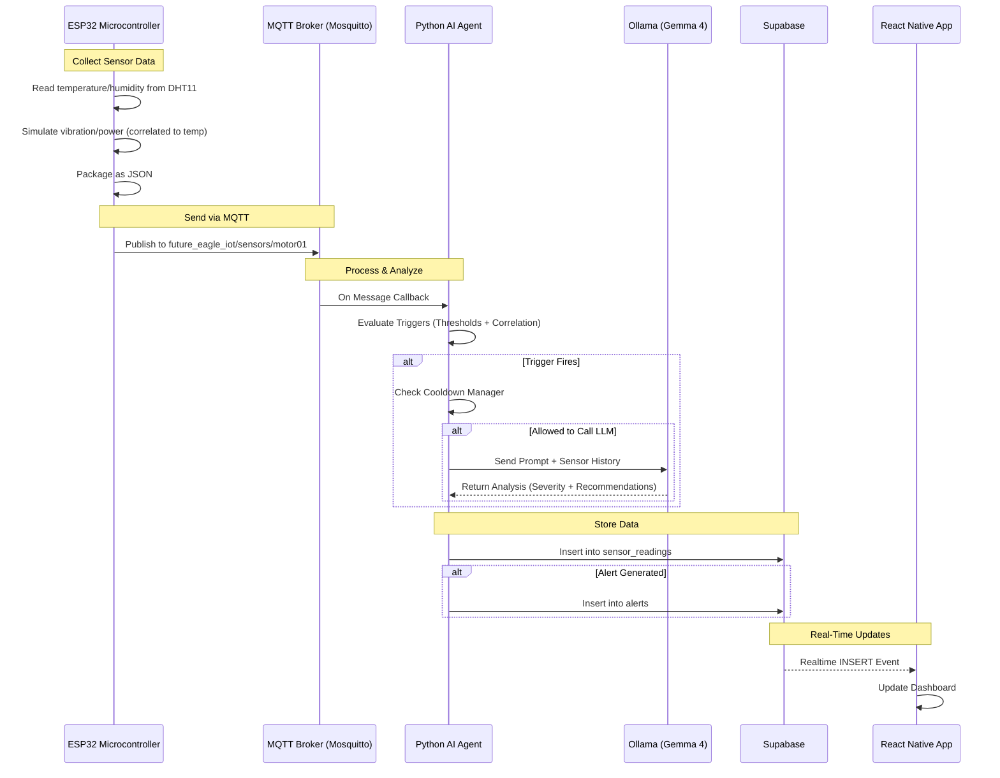

# Multi-Sensor AI Agent - Complete Project Guide

## Table of Contents
1. [Project Overview](#project-overview)
2. [System Architecture](#system-architecture)
3. [Data Flow Diagram](#data-flow-diagram)
4. [Components Deep Dive](#components-deep-dive)
5. [Real-World Industry Applications](#real-world-industry-applications)
6. [Problems Solved](#problems-solved)
7. [Setup Guide](#setup-guide)

---

## Project Overview

This is a **Industrial IoT (IIoT) Multi-Sensor AI Agent** system designed to monitor motor health in real-time using:
- **Embedded System**: ESP32 microcontroller + DHT11 sensor
- **Communication Protocol**: MQTT with TLS/mTLS security
- **AI/ML**: Google Gemma 4 (running locally via Ollama) for correlation analysis
- **Database**: Supabase PostgreSQL (time-series data + RLS security)
- **Mobile App**: React Native for real-time monitoring

### Core Objectives
1. Monitor motor health using 4 correlated signals
2. Detect anomalies early using AI-driven multi-signal correlation
3. Provide actionable insights for maintenance teams
4. Enable real-time data visualization via mobile app
5. Operate with minimal cloud dependency (local AI processing)

---

## System Architecture

```mermaid
graph TB
    subgraph "Edge Layer"
        ESP32["ESP32 Microcontroller<br/>(esp32_dht11.ino)"]
        DHT11["DHT11 Sensor<br/>(Temp + Humidity)"]
        ESP32 --> DHT11
    end

    subgraph "Network Layer"
        MQTT["MQTT Broker (Mosquitto)<br/>(docker-compose.yml)"]
        WiFi["WiFi Network"]
        ESP32 -- MQTT/TLS --> MQTT
    end

    subgraph "Processing Layer"
        Agent["Multi-Sensor AI Agent<br/>(multi_sensors_agent.py)"]
        Ollama["Ollama (Local LLM)<br/>Gemma 4:4b"]
        Agent -- Chat API --> Ollama
        MQTT -- Subscribe --> Agent
    end

    subgraph "Storage & Application Layer"
        Supabase["Supabase<br/>(PostgreSQL + Realtime)"]
        Mobile["React Native Mobile App"]
        Agent -- Insert --> Supabase
        Supabase -- Realtime Sub --> Mobile
    end

    style ESP32 fill:#ff9f43
    style DHT11 fill:#ee5a24
    style MQTT fill:#00d2d3
    style Agent fill:#54a0ff
    style Ollama fill:#f368e0
    style Supabase fill:#10ac84
    style Mobile fill:#222f3e
```



---

## Data Flow Diagram



---

## Components Deep Dive

### 1. Embedded Layer - ESP32 (esp32_dht11.ino)
**Hardware Components:**
- ESP32-WROOM-32
- DHT11 Temperature & Humidity Sensor (GPIO4)
- WiFi Connectivity

**Software Features:**
- WiFi station mode
- MQTT client (PubSubClient library)
- JSON serialization (ArduinoJson)
- Simulated sensors (vibration, power) correlated to real temperature data
- 5-second publish interval

### 2. Communication Layer - MQTT Broker (Mosquitto)
**Security:**
- TLS encryption on port 8883
- mTLS (mutual TLS) with CA, client, and broker certificates
- Certificate generation via generate_certs.sh
- WebSocket support (port 9001)

**Configuration:**
- Containerized via Docker Compose
- Persistent data and logs
- Auto-restart policy

### 3. AI Agent - Python (multi_sensors_agent.py)
**Key Modules:**

| Module | Purpose |
|--------|---------|
| MQTT Subscriber | Connects to broker, subscribes to sensor topic |
| Trigger Logic | Evaluates 3 types of anomalies: Hard thresholds, multi-signal correlation, rapid changes |
| Alert Cooldown Manager | Exponential backoff to prevent alert fatigue |
| Gemma 4 Integration | Local LLM for contextual analysis |
| Supabase ETL | Inserts readings and alerts into database |

**Trigger Types:**
1. **Hard Thresholds**: Single signal exceeds limits
2. **Multi-Signal Correlation**: ≥3 signals deviate from baseline simultaneously
3. **Rapid Change**: Temperature changes ≥3°C in 3 readings

### 4. Database - Supabase
**Schema:**
- `devices`: Device inventory
- `sensor_readings`: Time-series sensor data (indexed for performance)
- `alerts`: AI-generated alerts with severity

**Security:**
- Row Level Security (RLS) enabled
- Authenticated users can read
- Service role for ETL inserts
- Realtime subscriptions for mobile app

### 5. Mobile App - Expo (React Native)
**Features:**
- Auth (email) + guest read mode
- Live dashboard with health status and 4-signal metrics
- Alerts with filters, detail, resolve
- History + devices tabs
- Realtime subscriptions via Supabase
- Settings (account, connection, thresholds)

See `mobile_app/README.md`.

---

## Real-World Industry Applications

### 1. Manufacturing Plants
**Use Case**: Motor health monitoring on production lines
**Benefit**: Prevents unplanned downtime, reduces maintenance costs, extends motor lifespan

### 2. Mining & Heavy Industry
**Use Case**: Monitor motors in conveyor systems, crushers, and excavators
**Benefit**: Early detection of bearing wear, overheating, and electrical issues

### 3. Power Plants
**Use Case**: Generator and pump motor monitoring
**Benefit**: Ensures continuous power generation, avoids catastrophic failures

### 4. Logistics & Warehousing
**Use Case**: Conveyor belt motors and automated guided vehicles (AGVs)
**Benefit**: Maintains smooth operations in distribution centers

### 5. Agriculture (Irrigation Systems)
**Use Case**: Pump motor monitoring for irrigation
**Benefit**: Prevents crop loss due to pump failures, optimizes water usage

---

## Problems Solved

### 1. Traditional Threshold-Based Monitoring Limitations
- **Problem**: Single-signal alerts miss correlated failure patterns
- **Solution**: Multi-signal correlation with AI contextual analysis

### 2. Alert Fatigue
- **Problem**: Too many false positives lead to ignored alerts
- **Solution**: Exponential backoff cooldown + severity-based escalation

### 3. Cloud Dependency & Latency
- **Problem**: Sending raw data to cloud for AI causes latency and costs
- **Solution**: Local AI processing via Ollama (edge AI)

### 4. Lack of Actionable Insights
- **Problem**: Alerts without context lead to slow response
- **Solution**: Gemma 4 provides severity assessment + specific recommendations

### 5. Security Concerns
- **Problem**: Unencrypted IoT communication is vulnerable
- **Solution**: TLS/mTLS encryption + Supabase RLS for data security

---

## Setup Guide

### Prerequisites
- Python 3.8+
- Docker & Docker Compose
- Ollama installed locally
- ESP32 board + DHT11 sensor
- Supabase account
- Node.js (for mobile app)

### Step 1: Clone & Configure
```bash
git clone <repo>
cd Multi-Sensor-AI-Agent
cp .env.example .env
# Edit .env with your credentials
```

### Step 2: Generate Certificates
```bash
chmod +x generate_certs.sh
./generate_certs.sh
```

### Step 3: Start MQTT Broker
```bash
docker-compose up -d
```

### Step 4: Install Python Dependencies
```bash
pip install -r requirements.txt
```

### Step 5: Pull Gemma 4 Model
```bash
ollama pull gemma4:4b
```

### Step 6: Set Up Supabase
1. Create new Supabase project
2. Run schema.sql in SQL Editor
3. Get URL and Service Role key

### Step 7: Flash ESP32
1. Open esp32_dht11.ino in Arduino IDE
2. Update WiFi/MQTT credentials
3. Flash to ESP32

### Step 8: Run AI Agent
```bash
python multi_sensors_agent.py
```

### Step 9: Run Mobile App
```bash
cd mobile_app
cp .env.example .env
# Set EXPO_PUBLIC_SUPABASE_URL and EXPO_PUBLIC_SUPABASE_ANON_KEY
npm install
npx expo start
```

---

## Future Enhancements
1. Add real vibration/power sensors (replace simulation)
2. Implement historical trend analysis
3. Add predictive maintenance models
4. Support multiple motors/devices
5. Add email/SMS alert notifications
6. Implement OTA (Over-The-Air) updates for ESP32
7. Add data visualization dashboards (Grafana)

---

## License
See LICENSE file for details.
