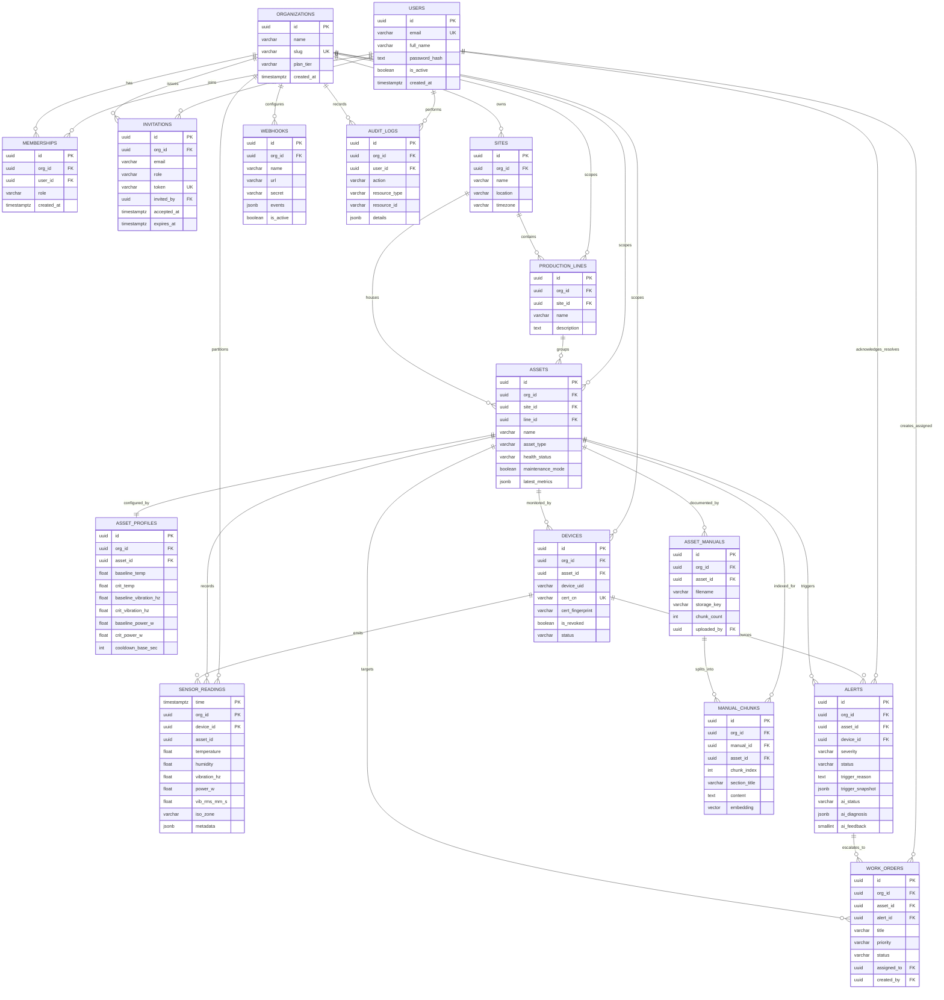
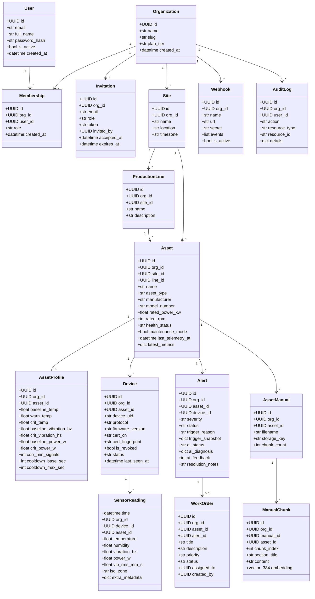

# Database Conception — ER Model (MLD) & UML Class Diagram

This document captures the full relational and domain conception for the **Future Eagle IIoT SaaS** database implemented in [schema.sql](./schema.sql) and [entities.py](../backend/app/models/entities.py).

---

## 1. Entity-Relationship Diagram (MLD)

---

## 2. UML Class Diagram (Domain & ORM Entities)

---

## 3. Three-Layer Multi-Tenancy & Security Model

1. **MQTT Broker Layer (EMQX `mqtt_acl` view):** Every edge device connects with a unique X.509 mTLS certificate whose Common Name (`CN`) is `{org_slug}:{device_uid}`. EMQX reads the live `mqtt_acl` SQL view and disconnects any device attempting to publish/subscribe outside `tenants/{org_slug}/devices/{device_uid}/#` or any device with `is_revoked = true`.
2. **API & RBAC Layer (FastAPI):** Every HTTP/WebSocket request validates a signed JWT (`org_id`, `role`), checks active `memberships`, and enforces role thresholds (`viewer < technician < engineer < admin < owner`).
3. **Database Layer (PostgreSQL Row-Level Security):** The API connects as the non-superuser `eagle_app` role and executes `SET LOCAL app.current_org_id = '<org_uuid>'` inside each transaction. All 13 tenant tables enforce `FORCE ROW LEVEL SECURITY`, making cross-tenant reads or mutations impossible even if a query omits a `WHERE org_id = ...` filter.
